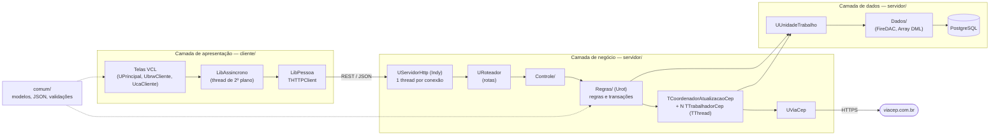

# Desafio Delphi — Cadastro de Pessoas (3 camadas, REST/JSON, FireDAC, Threads)

Cadastro de pessoas e endereços com cliente VCL e servidor REST em Delphi, persistência em
PostgreSQL via FireDAC, insert em lote de alto desempenho e atualização dos endereços
pelo ViaCEP usando threads.

| | |
|---|---|
| **Delphi** | desenvolvido e testado no Delphi 13 (Community). Evita recursos das versões mais recentes (sem *inline var*, sem operador ternário), mas usa `THTTPClient.ConnectionTimeout`/`ResponseTimeout`, disponíveis a partir do 10.1 Berlin; não foi compilado em versões anteriores |
| **Banco** | PostgreSQL 17 (qualquer versão ≥ 10 com a `libpq.dll` 64 bits) |
| **Plataforma** | Windows 64-bit |
| **Dependências externas** | nenhuma: apenas RTL, VCL, FireDAC e Indy, que acompanham o Delphi |

---

## Resultados medidos

| Cenário | Resultado |
|---|---|
| **Inclusão em lote** de 50.000 pessoas + 50.000 endereços | **1,8 s** no servidor, já incluindo a validação de todos os registros e a checagem de CPF/CNPJ único contra ~200 mil clientes (1,9 s contando a requisição HTTP com 5,8 MB de JSON) |
| **Atualização de endereços** (ViaCEP, 4 threads) | 55.000 endereços pendentes com 23 CEPs distintos → **23 consultas** ao ViaCEP, 50.001 endereços atualizados em **2,6 s**, 0 falhas (os demais tinham CEPs inexistentes no ViaCEP) |
| Testes automatizados | `TestesComum` (units compartilhadas), `TestesDados` (repositórios × PostgreSQL), `TestarServidor.ps1` (33 verificações), `TestarIntegracaoCep.ps1` — todos sem falhas |

---

## Manual de avaliação

### 1. Pré-requisitos

| Item | Observação |
|---|---|
| Delphi 10.1 Berlin ou superior | testado no Delphi 13 (Community Edition) |
| PostgreSQL 10 ou superior, **64 bits** | testado no 17; a `libpq.dll` 64 bits vem junto na instalação |
| Acesso à internet | só para a atualização de CEPs (ViaCEP) |

### 2. Criar o banco

No prompt de comando, dentro da pasta do projeto, ajustando a versão do PostgreSQL no caminho:

```bash
"C:\Program Files\PostgreSQL\17\bin\psql.exe" -U postgres -f banco\00_banco.sql
```

```bash
"C:\Program Files\PostgreSQL\17\bin\psql.exe" -U postgres -d teste_tecnico -f banco\01_estrutura.sql
```

Também dá para executar os dois scripts pelo pgAdmin ou pelo DBeaver.

### 3. Configurar o acesso ao banco — `servidor\Servidor.ini`

```ini
[Servidor]
PortaHttp=9000

[BancoDados]
Servidor=localhost
Porta=5432
Banco=teste_tecnico
Usuario=postgres
Senha=postgres
BibliotecaCliente=C:\Program Files\PostgreSQL\17\bin\libpq.dll
MaximoConexoes=50

[IntegracaoCep]
Url=https://viacep.com.br/ws/%s/json/
Threads=4
TimeoutMs=10000
```

- **`Senha`**: a senha do usuário `postgres` da sua instalação.
- **`BibliotecaCliente`**: caminho da `libpq.dll`. Troque o `17` se a sua versão for outra.

O `cliente\Cliente.ini` (`Url=http://localhost:9000`) só precisa mudar se o servidor rodar em outra
máquina ou porta. Os dois `.ini` são procurados ao lado do executável e, em seguida, na pasta do projeto.

### 4. Compilar e executar

1. Abra **`TesteTecnico.groupproj`** no Delphi. Os projetos já vêm em **Windows 64-bit**.
2. No Project Manager, clique com o botão direito no grupo e escolha **Build All**.
3. Execute o **Servidor**: selecione-o no Project Manager e pressione **Ctrl+Shift+F9** (executa sem depurar).
   No console deve aparecer:
   ```
   Conectado ao PostgreSQL localhost:5432/teste_tecnico
   Servidor REST ouvindo em http://localhost:9000
   ```
   Se o Windows perguntar sobre o firewall, permita em rede privada.
4. Execute o **Cliente**: selecione-o e pressione **F9**.

Os executáveis também podem ser abertos direto de `servidor\Win64\Debug\Servidor.exe` e
`cliente\Win64\Debug\Cliente.exe`.

> Abra os projetos pelo `.groupproj` ou pelo `.dproj`, e não pelo `.dpr`. Ao abrir um `.dpr` sem
> `.dproj`, a IDE gera um projeto só com Win32, e a `libpq.dll` do PostgreSQL atual é 64 bits.

### 5. Roteiro de uso (cada requisito do enunciado)

O Cliente abre na **tela principal**, com o menu no topo e o rodapé mostrando o banco conectado
(versão do PostgreSQL, servidor e nome do banco), a data e o desenvolvedor.

| # | O que fazer | O que deve acontecer |
|---|---|---|
| 1 | Menu **Cadastros → Clientes** | Abre a consulta de clientes: uma grade com rolagem contínua; o total aparece no rodapé da consulta |
| 2 | **Insert**: clique em **Novo**, escolha a natureza *Física*, informe um CPF válido (ex.: `529.982.247-25`), nome e sobrenome. Digite o CEP (ex.: `01001-000`) e clique em **Salvar** | A tela fecha só depois que o servidor confirma, e o cliente aparece na lista |
| 3 | **Validação e integridade**: em **Novo**, tente salvar sem nenhum endereço, com um CPF inválido ou com o CPF/CNPJ de um cliente que já existe | A tela avisa o problema (no caso do documento repetido, informando qual cliente já o usa) e continua aberta com os dados; nada é gravado |
| 4 | **Pessoa jurídica**: mude a natureza para *Jurídica* | Os rótulos passam para CNPJ, Razão social e Nome fantasia (ex. de CNPJ: `11.222.333/0001-81`) |
| 5 | **Update**: selecione um cliente e clique em **Editar** (ou dê duplo clique). A tela já abre com o CEP do primeiro endereço no campo: altere o CEP (ou o nome) e clique em **Salvar**. Para outro endereço, selecione-o na lista; **Novo endereço** e **Remover endereço** incluem e excluem | A lista mostra os dados atualizados |
| 6 | **Delete**: selecione um cliente e clique em **Excluir**, depois confirme | O cliente sai da lista; os endereços dele são removidos junto |
| 7 | **Inclusão em lote (clientes de teste)**: menu **Processos → Inclusão de clientes em lote**, em *Gerar clientes de teste* mantenha **50000** e clique em **Gerar e enviar** | Uma mensagem mostra o tempo de gravação no servidor (cerca de 2 s) e o tempo total; a consulta de clientes, se estiver aberta, recarrega |
| 7b | **Inclusão em lote (planilha Excel)**: na mesma tela, em *Importar planilha Excel*, clique em **Selecionar arquivo**, escolha `modelos\clientes_modelo.xlsx` e clique em **Importar** | Os 200 clientes da planilha são incluídos. Se alguma linha tiver problema (CPF inválido, CPF repetido ou já cadastrado, sem CEP etc.), nada é gravado e a tela lista as linhas da planilha a corrigir |
| 8 | **Threads/ViaCEP**: menu **Processos → Atualizar endereços pelo CEP (ViaCEP)** e responda **Sim** (somente pendentes) | A barra de progresso da tela principal avança; ao terminar, a consulta de clientes mostra logradouro, bairro e cidade/UF |
| 9 | **Reprocessar**: repita o item 8 respondendo **Não** (todos os endereços) | Todos os endereços são reconsultados e atualizados, sem duplicar registros |
| 9b | **Busca**: na consulta de clientes, digite no campo **Buscar** um nome (ex.: `conceição`), uma cidade (ex.: `curitiba`), o início de um CPF/CNPJ ou um CEP (ex.: `01001-000`) | A grade mostra só os clientes encontrados, meio segundo depois de parar de digitar (ou ao teclar Enter); o rodapé informa a quantidade. **Limpar** volta à lista completa |
| 10 | **Rolagem**: na consulta de clientes, role a grade até o fim (barra de rolagem, roda do mouse ou Ctrl+End) | As linhas aparecem conforme a rolagem; são buscadas no servidor em blocos de 500, só quando ficam visíveis |

No console do Servidor aparece uma linha por requisição, com método, rota, status e tempo.

### 6. Testes automatizados (opcional)

| Teste | Como rodar | O que cobre |
|---|---|---|
| `testes\TestesComum.dproj` | F9 na IDE; não precisa de banco | CPF/CNPJ, pessoa sem endereço, validação de lote, JSON ida e volta, paginação, leitura da planilha modelo e de uma planilha com erros (`testes\planilha_teste.xlsx`) |
| `testes\TestesDados.dproj` | F9 na IDE, com o banco criado | conexão, rollback, CRUD, sincronização de endereços, UPSERT, cascade, lote de 50 mil |
| `testes\TestarServidor.ps1` | com o Servidor rodando: `powershell -ExecutionPolicy Bypass -File testes\TestarServidor.ps1` | endpoints, erros HTTP, integridade, lote inválido, lote de 50 mil, paginação |
| `testes\TestarIntegracaoCep.ps1` | com o Servidor rodando: `powershell -ExecutionPolicy Bypass -File testes\TestarIntegracaoCep.ps1` (`-Todos` reprocessa tudo) | rotina com threads ponta a ponta, 409, CEP inexistente, dados gravados |

Todos terminam com `Falhas: 0`. `TestesDados` remove tudo o que cria; `TestarServidor.ps1` mantém as
pessoas do lote, que servem de massa para a rotina de CEP.

### 7. Problemas comuns

| Sintoma | Causa e solução |
|---|---|
| Servidor: `Cannot load vendor library [libpq.dll]` | Caminho errado em `BibliotecaCliente` no `Servidor.ini`, ou projeto compilado em 32 bits (tem que ser Win64) |
| Servidor: `password authentication failed` | Ajustar `Usuario`/`Senha` no `Servidor.ini` |
| Servidor: `database "teste_tecnico" does not exist` | Faltou executar o `banco\00_banco.sql` |
| Cliente: "Não foi possível comunicar com o servidor", ou rodapé com "servidor indisponível" | O Servidor não está rodando, ou a porta é diferente da do `Cliente.ini`. Com o Servidor no ar, abrir **Cadastros → Clientes** tenta de novo |
| Porta 9000 ocupada | Trocar `PortaHttp` no `Servidor.ini` e a `Url` no `Cliente.ini` |
| Atualização de CEPs com falhas | Sem acesso à internet, ou o ViaCEP limitou as requisições; basta rodar de novo |

---

## Arquitetura



- **Apresentação (`cliente/`)** — telas VCL. Nunca acessa o banco: consome apenas a API REST.
  Toda chamada ao servidor roda em segundo plano (`TAssincrono.Executar<T>`), então a tela não congela.
- **Negócio (`servidor/Web`, `Controle`, `Regras`, `Integracao`)** — API REST sobre Indy, com roteador
  próprio, validações, controle de transações e a rotina de integração com o ViaCEP.
- **Dados (`servidor/Dados`, `Infra`)** — repositórios FireDAC sobre um pool de conexões, com uma
  unidade de trabalho para operações em várias tabelas.
- **Comum (`comum/`)** — entidades, contrato JSON e regras de validação usados pelos dois lados.
  O cliente valida antes de enviar e o servidor valida de novo, com a mesma regra.

### Nomenclatura

Nomes em português, curtos. As units seguem estes prefixos:

| Prefixo | Uso | Exemplos |
|---|---|---|
| `Ubrw` | tela de consulta | `UbrwCliente` (`TfrmBrwCliente`) |
| `Uca` | tela de cadastro | `UcaCliente` (`TfrmCaCliente`), `UcaLote` (`TfrmCaLote`, inclusão em lote) |
| `Urot` | regras de negócio | `UrotPessoa`, `UrotAtualizacaoCep`, `UrotSistema`, `UrotValidacaoPessoa`, `UrotValidacaoDocumento` |
| `Lib` | procedures e functions de apoio às telas | `LibPessoa`, `LibGeradorPessoa`, `LibPlanilhaClientes`, `LibAssincrono`, `LibMensagem`, `LibTexto` |
| `U` | demais units | `UPrincipal` (menu), `UConexao`, `URepositorioPessoa`, `URoteador`, `UPessoa` |

Os fontes não têm comentários. As explicações de arquitetura e decisões estão neste README.

### Estrutura de pastas

```
├── TesteTecnico.groupproj     abre todos os projetos na IDE
├── banco/                     00_banco.sql, 01_estrutura.sql
├── comum/                     UPessoa, UEntidade, UPagina, UStatusCep, USistema, UConversorJson, UExcecoes,
│                              UrotValidacaoPessoa, UrotValidacaoDocumento, LibTexto
├── servidor/                  Servidor.dproj, Servidor.ini, UAplicacao (monta as dependências)
│   ├── Web/                   UServidorHttp (Indy), URoteador
│   ├── Controle/              UControlePessoa, UControleCep, UControleSistema
│   ├── Regras/                UrotPessoa, UrotSistema, UrotAtualizacaoCep (threads)
│   ├── Integracao/            UViaCep
│   ├── Dados/                 URepositorioBase, URepositorioPessoa, URepositorioEndereco,
│   │                          URepositorioIntegracao, URepositorioSistema, UUnidadeTrabalho
│   └── Infra/                 UConfiguracao, UConexao (pool), ULog
├── cliente/                   Cliente.dproj, Cliente.ini, UConfiguracaoCliente
│   ├── Telas/                 UPrincipal (menu e rodapé), UbrwCliente, UcaCliente, UcaLote
│   └── Lib/                   LibPessoa, LibGeradorPessoa, LibPlanilhaClientes, LibAssincrono,
│                              LibMensagem (mensagens em português)
├── modelos/                   clientes_modelo.xlsx (200 clientes, modelo de importação)
└── testes/                    TestesComum, TestesDados, TestarServidor.ps1, TestarIntegracaoCep.ps1
```

---

## API REST

Todas as respostas são JSON (UTF-8). Os erros seguem o formato `{"erro": "...", "detalhes": ["..."]}`.

| Método | Rota | Resposta |
|---|---|---|
| `GET` | `/pessoas?pagina=1&tamanho=100&busca=texto` | `200` página com `dados`, `totalRegistros` e `totalPaginas` (tamanho máximo 1000). `busca` (opcional): texto procura em nome, sobrenome, razão social, nome fantasia e cidade (qualquer parte, sem diferenciar maiúsculas); número procura CPF/CNPJ ou CEP que comecem com os dígitos |
| `GET` | `/pessoas/{id}` | `200` pessoa com endereços e dados de integração · `404` |
| `POST` | `/pessoas` | `201` pessoa criada · `400` validação |
| `PUT` | `/pessoas/{id}` | `200` pessoa atualizada · `400` · `404` |
| `DELETE` | `/pessoas/{id}` | `204` · `404` |
| `POST` | `/pessoas/lote` | `201` `{"inseridos": n, "tempoMs": t}` · `400` com a lista dos registros inválidos |
| `POST` | `/pessoas/documentos` | `200` recebe uma lista de CPF/CNPJ e devolve os que já estão cadastrados |
| `POST` | `/enderecos/atualizacao-cep?somentePendentes=true` | `202` rotina iniciada · `409` se já estiver em andamento |
| `GET` | `/enderecos/atualizacao-cep` | `200` andamento: percentual, CEPs processados, endereços atualizados, não encontrados, falhas |
| `GET` | `/sistema` | `200` informações do banco para o rodapé do cliente: `versao`, `servidor`, `porta`, `banco` |

Exemplo de pessoa:

```json
{
  "natureza": 1,
  "documento": "529.982.247-25",
  "primeiroNome": "João",
  "segundoNome": "Conceição",
  "enderecos": [ { "cep": "01001-000" } ]
}
```

`natureza`: 1 = física (CPF), 2 = jurídica (CNPJ). As máscaras são removidas pelo servidor.
Na resposta, cada endereço traz `integracao` (`uf`, `cidade`, `bairro`, `logradouro`, `complemento`)
depois que a rotina do ViaCEP roda.

---

## Decisões técnicas

### Integridade: não existe pessoa sem endereço

1. **Validação** (`TPessoaValidador` em `UrotValidacaoPessoa`, usada pelo cliente e pelo servidor): exige ao menos um endereço com CEP de 8 dígitos.
   O cliente bloqueia antes de enviar e o servidor valida de novo.
2. **Transação única** (`IUnidadeTrabalho.ExecutarEmTransacao`): pessoa e endereços são gravados
   juntos. Qualquer falha desfaz tudo.
3. **Alteração por sincronização** (`SincronizarDaPessoa`): exclui os endereços removidos, atualiza
   os existentes (descartando os dados do ViaCEP quando o CEP muda) e insere os novos, na mesma
   transação e sempre depois da validação.
4. **Sem exclusão isolada de endereço** na API. A exclusão da pessoa remove os endereços por
   `ON DELETE CASCADE`.

### Tela de cadastro

A tela de cadastro envia os dados e só fecha quando o servidor confirma. Se a gravação for
recusada, a mensagem aparece e os dados continuam na tela para correção.

### CPF/CNPJ único

Um documento pertence a um único cliente. A regra fica no servidor (`UrotPessoa`), numa única
consulta ao banco (`DocumentosCadastrados`, com `unnest` + junção, eficiente mesmo para 50 mil
documentos):

- **Inclusão e alteração**: recusa (400) um documento que já pertence a **outro** cliente e informa
  qual. Na alteração, o cliente pode manter o próprio documento.
- **Lote**: recusa documentos repetidos dentro do próprio lote e documentos já cadastrados,
  informando o número de cada registro. Vale o tudo ou nada.
- **Gerador de massa do cliente**: não repete documentos dentro do lote e, antes de enviar,
  consulta `POST /pessoas/documentos` para trocar os que já existem no banco.

A estrutura do banco segue exatamente o DDL do enunciado, sem índice único em `dsdocumento`. Por
isso, a garantia é da aplicação: dois cadastros **simultâneos** do mesmo documento ainda poderiam
passar. Um índice único seria o reforço natural se a estrutura pudesse ser alterada.

### Inclusão em lote performática (50.000 registros)

1. Todo o lote é **validado antes** de gravar, inclusive CPF/CNPJ repetido no próprio lote ou já cadastrado: se houver registro inválido, nada é gravado e a
   resposta lista os registros com problema.
2. Os IDs são **reservados em um único comando** na sequence
   (`nextval(...) from generate_series(1, n)`). Assim os endereços já sabem o `idpessoa` sem
   `RETURNING` linha a linha.
3. Gravação com **FireDAC Array DML** em blocos de 5.000 linhas, com os parâmetros tipados (e os
   tamanhos definidos) antes da execução.
4. **Uma única transação** para pessoas e endereços.

O método genérico `TRepositorioBase.ExecutarEmLote<T>` concentra essa lógica e é reaproveitado pelas três tabelas.

### Importação por planilha Excel

- A tela **Processos → Inclusão de clientes em lote** (`UcaLote`) aceita um arquivo `.xlsx` no layout
  de `modelos\clientes_modelo.xlsx`: *Natureza*, *CPF/CNPJ*, *Nome / Razão social*,
  *Sobrenome / Nome fantasia* e *CEP* (vários separados por `;`). A aba *Instruções* do modelo
  descreve as regras.
- A leitura (`LibPlanilhaClientes`) **não depende do Excel instalado**: o `.xlsx` é aberto como ZIP
  (`System.Zip`) e as partes XML são lidas com o OmniXML do Delphi, sem COM, o que permite ler em
  segundo plano. Aceita textos compartilhados e texto direto, e recoloca os zeros à esquerda de
  CPF/CNPJ/CEP digitados como número.
- Antes de enviar, cada linha passa pela mesma validação do cadastro e pela checagem de documento
  repetido na própria planilha. Os problemas aparecem **pelo número da linha da planilha**. Se o
  servidor recusar (ex.: CPF já cadastrado), a tela converte "Registro N" para a linha correspondente.
- O envio usa o mesmo `POST /pessoas/lote`, com as mesmas regras (tudo ou nada, Array DML, transação única).

### Rotina com threads (ViaCEP)

- **Producer-Consumer**: `TCoordenadorAtualizacaoCep` (TThread) lê os CEPs e publica o trabalho em uma
  `TThreadedQueue<T>`. Os N `TTrabalhadorCep` (TThread, 4 por padrão) consomem a fila.
  O encerramento é sinalizado com uma sentinela por trabalhador.
- **Um CEP é consultado uma única vez**: os endereços são agrupados por CEP e o resultado é gravado para
  todos os endereços do grupo em um único UPSERT com Array DML.
  Com a massa de teste, isso reduziu 55 mil consultas para 23.
- **Cada thread tem sua conexão** (tirada do pool) e seu `THTTPClient`, porque nenhum dos dois é thread-safe.
- **Progresso** em `TProgressoAtualizacaoCep`, protegido por `TCriticalSection`. A consulta recebe uma
  cópia (`Fotografia`), então quem lê não disputa acesso com as threads.
- **Robustez**: timeout, até 3 tentativas com espera crescente em 429/5xx e falhas de rede; CEP
  inexistente (`{"erro": "true"}` ou HTTP 400) é contado como "não encontrado"; uma segunda execução
  simultânea responde 409; ao encerrar o servidor, a rotina é cancelada e as threads são aguardadas.
- **UPSERT** (`INSERT ... ON CONFLICT DO UPDATE`) permite reprocessar sem duplicar registros.
  O `INSERT ... SELECT` ignora endereços excluídos durante a execução.

### Padrões de projeto

| Padrão | Onde |
|---|---|
| Repository | `IRepositorioPessoa`, `IRepositorioEndereco`, `IRepositorioIntegracao` |
| Unit of Work (unidade de trabalho) | `IUnidadeTrabalho` (repositórios sobre a mesma conexão + transação) |
| Factory | `IFabricaConexao`, `IFabricaUnidadeTrabalho`, `TFabricaValidadorDocumento`, `TFabricaConsultaCep` |
| Strategy | `IValidadorDocumento` → `TValidadorCpf` / `TValidadorCnpj` |
| Template Method | `TValidadorDocumentoModulo11.EhValido` (os filhos informam tamanho e pesos) |
| Producer-Consumer | coordenador + trabalhadores com `TThreadedQueue<T>` |
| Front Controller | `TRoteador`: rotas, parâmetros e conversão de exceções em HTTP |
| Mapper / DTO | `TPessoaJson`, `TStatusAtualizacaoCepJson`, `TInformacoesBancoJson` |
| Composition Root / Injeção de dependência | `TAplicacaoServidor` monta e conecta todas as dependências por construtor |

### POO, generics e gerenciamento de memória

- **Herança**: `TEntidade` → `TPessoa`/`TEndereco`; `TRepositorioBase` → repositórios;
  `TValidadorDocumentoModulo11` → CPF/CNPJ; `TThread` → coordenador e trabalhadores.
- **Polimorfismo**: métodos `virtual; abstract` nos validadores e dependências sempre por interface
  (`IRegraPessoa`, `IConsultaCep` etc.), o que permite trocar implementações e testá-las isoladamente.
- **Encapsulamento**: campos `private` expostos por `property`. A posse dos objetos segue uma regra
  única: funções que devolvem objeto (`Obter`, `Listar`, `Gerar`...) transferem a posse a quem chama,
  e listas `TObjectList` são donas dos itens.
- **Generics**: `TPagina<T>`, `ExecutarEmLote<T>`, `TPreenchimentoLote<T>`, `TAssincrono.Executar<T>`,
  `TThreadedQueue<T>`, `TObjectList<T>`, `TObjectDictionary<K,V>`.
- **Criação e destruição de objetos**: `try..finally` em toda criação; funções que devolvem objeto usam
  `try..except Free; raise`; listas que são donas dos itens (`TObjectList`); interfaces com contagem de
  referência para serviços e repositórios; `ReportMemoryLeaksOnShutdown` ligado em Debug.

### Outras decisões

- **Indy + roteador próprio** em vez de DataSnap ou frameworks de terceiros: funciona em qualquer
  edição do Delphi e não depende de bibliotecas externas.
- **Pool de conexões FireDAC** (`Pooled=True`): o Indy atende cada conexão em uma thread, e cada uma
  pega sua conexão do pool.
- **Busca no servidor**: o filtro da consulta vai na própria listagem (`GET /pessoas?busca=`), então a rolagem sob demanda continua valendo dentro do resultado. Os parâmetros da URL são decodificados em UTF-8 pelo servidor, para buscas com acento. Medido com ~150 mil clientes: 30 a 45 ms por número e cerca de 320 ms por texto (`ilike` em qualquer parte do texto, sem índice, porque a estrutura do enunciado foi mantida).
- **Grade virtual** na consulta de clientes (`TListView` com `OwnerData`): a grade já nasce com o total de linhas e só busca no servidor os blocos de 500 que ficam visíveis ao rolar, guardando os já carregados. Rola por 150 mil clientes sem trafegar nem montar todos de uma vez.
- **Arquivos-fonte em UTF-8 com BOM**, para que os acentos das mensagens sejam lidos corretamente
  pelo compilador em qualquer versão.
